# LAPORAN TUGAS PROYEK INDIVIDUAL
# UJIAN TENGAH SEMESTER (UTS) SISTEM PAKAR
**SEMESTER GANJIL 2026/2027**

---

### IDENTITAS MAHASISWA & MATA KULIAH
* **Mata Kuliah:** Sistem Pakar (Kode MK: TI22604)
* **Dosen Pengampu:** Haris Setiaji, M.T.I
* **Program Studi:** S1 Teknik Informatika / S1 Sistem Informasi
* **Fakultas:** Fakultas Teknologi Bisnis dan Sains (FTBS)
* **Perguruan Tinggi:** Universitas Dharma Wacana
* **Judul Sistem Pakar:** **CabaiCare – Sistem Pakar dan Deteksi Kondisi Tanaman Cabai Menggunakan Metode Forward Chaining dan AI Computer Vision**

---

## FORMULIR USULAN KASUS SISTEM PAKAR

| Komponen | Isian Mahasiswa |
| :--- | :--- |
| **NIM dan Nama** | *(Diisi Mahasiswa)* |
| **Kelas** | 7TI-R1 / 7TI-R2 |
| **Judul Sistem Pakar** | CabaiCare – Sistem Pakar dan Deteksi Kondisi Tanaman Cabai |
| **Bidang atau Domain** | Pertanian Digital / Perlindungan Tanaman Hortikultura (*Plant Pathology Decision Support*) |
| **Masalah yang Diselesaikan** | Tingginya risiko gagal panen cabai akibat serangan penyakit patogen (virus kuning bule, antraknosa patek, layu bakteri, layu fusarium, dan busuk buah phytophthora) yang sulit dibedakan pada fase awal oleh petani awam tanpa bantuan pakar agronomi di lahan. |
| **Calon Pengguna Sistem** | Petani cabai, kelompok tani (Poktan), penyuluh pertanian lapangan (PPL), akademisi, dan praktisi agribisnis hortikultura. |
| **Keluaran yang Dihasilkan** | 1. Diagnosis penyakit pasti atau indikasi belum dapat ditentukan.<br>2. Derajat keyakinan berbasis data nyata (tanpa manipulasi probabilitas palsu).<br>3. Fasilitas penjelasan jejak aturan (*explanation facility/rule firing trace*).<br>4. Rekomendasi penanganan organik, kimiawi terukur, dan tindakan pencegahan sanitasi lahan. |
| **Metode Inferensi** | **Forward Chaining** (*Data-Driven Reasoning*) dikombinasikan dengan modul *Computer Vision* untuk analisis citra digital. |
| **Sumber Pengetahuan** | 1. Balai Penelitian Tanaman Sayuran (BALITSA) - Badan Litbang Kementan RI.<br>2. Jurnal Fitopatologi Indonesia (Kajian Morfologis dan Epidemiologi Patogen Tanaman Cabai).<br>3. Jurnal Perlindungan Tanaman Indonesia (*Ralstonia solanacearum* dan *Fusarium oxysporum*). |
| **Alasan Memilih Kasus** | Komoditas cabai memiliki nilai ekonomi strategis di Indonesia namun rentan terhadap fluktuasi harga akibat serangan penyakit musiman. Penanganan yang salah (misalnya salah membedakan layu bakteri dengan layu fusarium) menyebabkan pemborosan pestisida kimia berbahaya dan kematian tanaman secara massal. |

---

## RINGKASAN SISTEM
CabaiCare adalah platform sistem pakar hibrida yang dirancang untuk mengatasi permasalahan diagnostik patologi tanaman cabai. Sistem mengimplementasikan penalaran **Forward Chaining** pada backend Golang berbasis 18 fakta gejala lapangan, 4 kesimpulan antara (*intermediate states*), dan 18 aturan produksi ilmiah untuk mendiagnosis 7 kondisi penyakit utama. Di samping itu, CabaiCare dilengkapi modul *Computer Vision* terisolasi untuk klasifikasi visual penyakit daun, kerusakan buah, dan tingkat kematangan cabai guna membantu estimasi waktu panen ideal. Antarmuka sistem dibangun responsif menggunakan Next.js App Router, TypeScript, dan Tailwind CSS.

---

## BAB 1: PENDAHULUAN

### 1.1 Calon Pengguna
1. **Petani Cabai & Kelompok Tani:** Membutuhkan panduan diagnostik lapangan cepat tanpa harus menunggu kedatangan penyuluh saat terjadi gejala kelayuan atau bercak abnormal.
2. **Penyuluh Pertanian Lapangan (PPL):** Menggunakan sistem sebagai instrumen verifikasi berbasis kaidah literatur ilmiah saat memberikan rekomendasi obat tani kepada petani binaan.
3. **Akademisi & Peneliti Pertanian:** Memanfaatkan basis aturan dan visualisasi inferensi untuk analisis pola penyakit cabai.

### 1.2 Ruang Lingkup Sistem
1. Diagnosis gangguan patologis tanaman cabai mencakup organ **daun, batang, buah, dan perakaran**.
2. Identifikasi 7 penyakit/kondisi utama:
   - Penyakit Virus Kuning (*Gemini Virus / Bule*)
   - Penyakit Bercak Daun Cercospora (*Mata Katak*)
   - Penyakit Layu Bakteri (*Ralstonia solanacearum*)
   - Penyakit Layu Fusarium (*Fusarium oxysporum*)
   - Penyakit Antraknosa / Patek Buah (*Colletotrichum capsici*)
   - Penyakit Busuk Buah & Hawar Daun Phytophthora (*Phytophthora capsici*)
   - Serangan Hama Thrips & Kutu Daun Tungau (*Thrips parvispinus*)
3. Fasilitas penelusuran aturan (*Explanation Facility*) yang mendokumentasikan setiap iterasi *working memory* dan aturan yang ditembakkan (*rules fired*).
4. Modul deteksi visual citra menggunakan arsitektur deep learning untuk daun, kebusukan buah, dan kematangan panen.

### 1.3 Batasan Sistem
1. Sistem bertindak sebagai *Decision Support System* (alat bantu keputusan awal di lapangan), bukan pengganti uji kultur isolat laboratorium mikrobiologi patologi tanaman resmi.
2. Metode Forward Chaining bekerja secara deterministik berdasarkan pemenuhan premis logika boolean (AND/OR). Sistem tidak membuat persentase keyakinan semu pada sistem pakar.
3. Modul Computer Vision membutuhkan foto dengan pencahayaan cukup dan fokus tajam pada organ tanaman yang diuji.

---

## BAB 2: AKUISISI DAN REPRESENTASI PENGETAHUAN

### 2.1 Sumber Pengetahuan Terverifikasi
1. **Sumber 1: Balai Penelitian Tanaman Sayuran (BALITSA) - Kementan RI**
   - *Judul:* Pengenalan dan Pengendalian Hama dan Penyakit Penting Tanaman Cabai (Sastrosiswojo et al., 2021).
   - *Kontribusi:* Klasifikasi morfologis gejala khas pada daun, batang, dan penularan virus gemini oleh vektor *Bemisia tabaci*.
2. **Sumber 2: Jurnal Fitopatologi Indonesia**
   - *Judul:* Karakteristik Morfologis dan Patogenisitas *Colletotrichum spp.* Penyebab Antraknosa Cabai (Sudir & Nuryanto, 2022).
   - *Kontribusi:* Pengetahuan struktur lesi konsentris cekung dan sporulasi oranye patek buah.
3. **Sumber 3: Jurnal Perlindungan Tanaman Indonesia**
   - *Judul:* Diagnostik dan Epidemiologi *Ralstonia solanacearum* pada Tanaman Solanaceae di Indonesia (Supriadi & Sitepu, 2020).
   - *Kontribusi:* Prosedur pembuktian uji celup batang berlendir (*bacterial streaming test*) untuk membedakan Layu Bakteri dengan Layu Jamur Fusarium.

### 2.2 Daftar Istilah dan Definisi Operasional
1. **Klorosis:** Kondisi perubahan warna jaringan daun dari hijau segar menjadi kuning pucat akibat kerusakan klorofil.
2. **Nekrosis:** Kematian lokal sel atau jaringan tumbuhan yang tampak berupa bercak cokelat hingga kehitaman.
3. **Lesi Konsentris:** Pola bercak melingkar berulang melekuk ke dalam menyerupai cincin sasaran bidik, khas pada serangan jamur *Colletotrichum*.
4. **Bacterial Ooze (Lendir Bakteri):** Eksudat cairan kental keruh yang keluar dari berkas pembuluh tanaman terinfeksi bakteri saat dipotong dan direndam di air bersih.
5. **Vaskular (Xilem):** Jaringan pembuluh pengangkut air dari akar ke daun yang kerap disumbat oleh hifa jamur *Fusarium* atau massa sel bakteri *Ralstonia*.
6. **Turning (Peralihan Kematangan):** Fase perubahan warna buah cabai dari hijau ke oranye sebelum matang merah penuh.

### 2.3 Basis Fakta / Gejala (18 Fakta)

| Kode | Nama Fakta / Gejala | Bagian | Domain Nilai | Sumber Pengetahuan |
| :--- | :--- | :--- | :--- | :--- |
| **G01** | Daun menguning secara menyeluruh atau klorosis bercak | Daun | Boolean [Ya/Tidak] | BALITSA Kementan RI |
| **G02** | Daun menggulung ke atas / keriting dan mengkerut | Daun | Boolean [Ya/Tidak] | BALITSA Kementan RI |
| **G03** | Terdapat kutu kebul (serangga putih kecil) di balik daun | Daun | Boolean [Ya/Tidak] | BALITSA Kementan RI |
| **G04** | Bercak bulat kecil cokelat tepi gelap pusat abu-abu ("mata katak") | Daun | Boolean [Ya/Tidak] | Jurnal Fitopatologi |
| **G05** | Daun berlubang atau mengering dan gugur prematur | Daun | Boolean [Ya/Tidak] | Jurnal Fitopatologi |
| **G06** | Tanaman layu mendadak di siang hari, segar kembali sore/malam | Seluruh | Boolean [Ya/Tidak] | Jurnal Perlindungan Tanaman |
| **G07** | Layu permanen bertahap dari daun bawah menjalar ke atas | Seluruh | Boolean [Ya/Tidak] | Jurnal Perlindungan Tanaman |
| **G08** | Berkas pembuluh xilem pangkal batang berwarna cokelat kehitaman | Batang | Boolean [Ya/Tidak] | Jurnal Perlindungan Tanaman |
| **G09** | Keluar lendir bakteri putih keruh saat potongan batang direndam air | Batang | Boolean [Ya/Tidak] | Uji Ooze Supriadi (2020) |
| **G10** | Bercak konsentris melekuk cekung berwarna cokelat tua pada buah | Buah | Boolean [Ya/Tidak] | Sudir & Nuryanto (2022) |
| **G11** | Terbentuk massa spora berwarna oranye atau merah muda di lesi buah | Buah | Boolean [Ya/Tidak] | Sudir & Nuryanto (2022) |
| **G12** | Buah cabai membusuk basah dan berair dari ujung atau tangkai | Buah | Boolean [Ya/Tidak] | BALITSA Kementan RI |
| **G13** | Bercak cokelat kebasahan pada batang atau tangkai buah (hawar) | Batang | Boolean [Ya/Tidak] | BALITSA Kementan RI |
| **G14** | Pertumbuhan tanaman terhambat kerdil (*stunting*) | Seluruh | Boolean [Ya/Tidak] | BALITSA Kementan RI |
| **G15** | Permukaan bawah daun berwarna perak mengkilap atau kecokelatan | Daun | Boolean [Ya/Tidak] | BALITSA Kementan RI |
| **G16** | Bunga mudah rontok sebelum berhasil menjadi buah | Seluruh | Boolean [Ya/Tidak] | BALITSA Kementan RI |
| **G17** | Buah mengkerut mengering seperti jerami terbakar (*mummified*) | Buah | Boolean [Ya/Tidak] | Sudir & Nuryanto (2022) |
| **G18** | Bercak basah cokelat tua menyebar sangat cepat saat hujan lembab | Daun | Boolean [Ya/Tidak] | BALITSA Kementan RI |

### 2.4 Kesimpulan Antara dan Kesimpulan Akhir
* **Kesimpulan Antara (*Intermediate States*):**
  - **K01:** Kondisi Klorosis & Malformasi Daun
  - **K02:** Kondisi Gangguan Vaskular Sistemik
  - **K03:** Kondisi Nekrosis Buah Cekung
  - **K04:** Kondisi Pembusukan Basah Phytophthora
* **Kesimpulan Akhir (*Final Hypotheses*):**
  - **P01:** Penyakit Virus Kuning (*Gemini Virus / Bule*)
  - **P02:** Penyakit Bercak Daun Cercospora (*Mata Katak*)
  - **P03:** Penyakit Layu Bakteri (*Ralstonia solanacearum*)
  - **P04:** Penyakit Layu Fusarium (*Fusarium oxysporum*)
  - **P05:** Penyakit Antraknosa / Patek Buah (*Colletotrichum capsici*)
  - **P06:** Penyakit Busuk Buah & Hawar Phytophthora (*Phytophthora capsici*)
  - **P07:** Serangan Hama Thrips & Kutu Daun Tungau

### 2.5 Basis Aturan Produksi (18 Aturan IF-THEN)

```text
R01: IF G01 AND G02 THEN K01 (Kondisi Klorosis & Malformasi Daun)
R02: IF K01 AND G03 AND G14 THEN P01 (Penyakit Virus Kuning)
R03: IF G01 AND G02 AND G15 THEN P07 (Serangan Hama Thrips/Tungau)
R04: IF G04 AND G05 THEN P02 (Bercak Daun Cercospora)
R05: IF G04 AND G18 THEN P02 (Bercak Daun Cercospora)
R06: IF G06 AND G08 THEN K02 (Kondisi Gangguan Vaskular Sistemik)
R07: IF K02 AND G09 THEN P03 (Layu Bakteri)
R08: IF G07 AND G08 THEN K02 (Kondisi Gangguan Vaskular Sistemik)
R09: IF K02 AND NOT G09 THEN P04 (Layu Fusarium)
R10: IF G07 AND G08 AND G14 THEN P04 (Layu Fusarium)
R11: IF G10 AND G11 THEN K03 (Kondisi Nekrosis Buah Cekung)
R12: IF K03 AND G17 THEN P05 (Antraknosa / Patek Buah)
R13: IF G10 AND G17 THEN P05 (Antraknosa / Patek Buah)
R14: IF G12 AND G13 THEN K04 (Kondisi Pembusukan Basah Phytophthora)
R15: IF K04 AND G18 THEN P06 (Busuk Hawar Phytophthora)
R16: IF G12 AND G18 THEN P06 (Busuk Hawar Phytophthora)
R17: IF G01 AND G06 AND G09 THEN P03 (Layu Bakteri Gejala Lanjut)
R18: IF G02 AND G14 AND G16 THEN P01 (Penyakit Virus Kuning Fase Awal)
```

### 2.6 Pohon Keputusan / Graf Dependensi Aturan
Struktur hubungan penjalaran fakta menuju kesimpulan direpresentasikan dalam graf berikut:

```mermaid
flowchart TD
    subgraph Fakta_Daun [Fakta Organ Daun]
        G01["G01: Klorosis"]
        G02["G02: Keriting"]
        G03["G03: Kutu Kebul"]
        G04["G04: Mata Katak"]
        G05["G05: Daun Gugur"]
        G15["G15: Bawah Perak"]
        G18["G18: Sebar Cepat"]
    end

    subgraph Fakta_Batang_Akar [Fakta Batang & Vaskular]
        G06["G06: Layu Siang Hari"]
        G07["G07: Layu Bertahap"]
        G08["G08: Pembuluh Cokelat"]
        G09["G09: Lendir Bakteri"]
        G13["G13: Hawar Tangkai"]
        G14["G14: Kerdil"]
        G16["G16: Bunga Rontok"]
    end

    subgraph Fakta_Buah [Fakta Organ Buah]
        G10["G10: Lesi Cekung"]
        G11["G11: Spora Oranye"]
        G12["G12: Busuk Berair"]
        G17["G17: Buah Kering Jerami"]
    end

    subgraph Kesimpulan_Antara [Kesimpulan Antara]
        K01["K01: Malformasi Daun"]
        K02["K02: Gangguan Vaskular"]
        K03["K03: Nekrosis Buah"]
        K04["K04: Busuk Basah"]
    end

    subgraph Kesimpulan_Akhir [Kesimpulan Akhir Penyakit]
        P01["P01: Virus Kuning / Gemini"]
        P02["P02: Cercospora Mata Katak"]
        P03["P03: Layu Bakteri"]
        P04["P04: Layu Fusarium"]
        P05["P05: Antraknosa Patek"]
        P06["P06: Phytophthora Hawar"]
        P07["P07: Hama Thrips"]
    end

    G01 & G02 -->|R01| K01
    K01 & G03 & G14 -->|R02| P01
    G01 & G02 & G15 -->|R03| P07
    G04 & G05 -->|R04| P02
    G04 & G18 -->|R05| P02
    G06 & G08 -->|R06| K02
    G07 & G08 -->|R08| K02
    K02 & G09 -->|R07| P03
    K02 -->|R09 Tanpa Ooze| P04
    G07 & G08 & G14 -->|R10| P04
    G10 & G11 -->|R11| K03
    K03 & G17 -->|R12| P05
    G10 & G17 -->|R13| P05
    G12 & G13 -->|R14| K04
    K04 & G18 -->|R15| P06
    G12 & G18 -->|R16| P06
    G01 & G06 & G09 -->|R17| P03
    G02 & G14 & G16 -->|R18| P01
```



### 2.7 Analisis Konsistensi Aturan
1. **Pemeriksaan Aturan Berulang (*Redundant Rules*):** Tidak terdapat aturan dengan premis dan kesimpulan yang identik secara persis. Setiap aturan menangani skenario manifestasi gejala yang berbeda (misalnya R12 menangani gejala lengkap dengan sporulasi K03, sedangkan R13 menangani varian lapangan tanpa sporulasi nyata).
2. **Pemeriksaan Konflik Aturan (*Conflicting Rules*):** Tidak ada premis identik yang menghasilkan kesimpulan penyakit berbeda yang saling kontradiktif. Layu Bakteri (P03) dan Layu Fusarium (P04) dibedakan secara tegas melalui keberadaan fakta lendir bakteri G09 (uji *ooze*).
3. **Pemeriksaan Premis Tidak Terpakai (*Unused Premises*):** Seluruh 18 fakta gejala (G01 s.d G18) digunakan minimal pada satu aturan produksi.
4. **Pemeriksaan Kesimpulan yang Tidak Dapat Dicapai (*Unreachable Conclusions*):** Seluruh 7 kesimpulan akhir penyakit (P01 s.d P07) dan 4 kesimpulan antara (K01 s.d K04) memiliki jalur aturan yang dapat dicapai dari fakta-fakta masukan awal.

---

## BAB 3: PERANCANGAN SISTEM

### 3.1 Arsitektur Sistem
Sistem dibangun dengan arsitektur *Client-Server Decoupled*:
1. **Presentation Layer (Frontend):** Next.js 14 App Router, TypeScript, React, Tailwind CSS, Lucide Icons, dan Recharts.
2. **Business Logic & Inference Layer (Backend):** Golang REST API, modul `internal/expert` (Forward Chaining Engine), modul `internal/services` (Computer Vision Adapter).
3. **Persistence Layer (Database):** Supabase PostgreSQL dengan 10 entitas relasional terstruktur dan store in-memory terkalibrasi.

### 3.2 Diagram Alur Forward Chaining
1. Pengguna memilih fakta-fakta gejala awal.
2. Fakta awal dimasukkan ke dalam **Working Memory**.
3. Sistem memindai basis aturan untuk membentuk **Conflict Set** (kumpulan aturan yang premisnya terpenuhi).
4. Jika Conflict Set kosong, penalaran berhenti.
5. Aturan dengan prioritas kesimpulan antara ditembakkan (*fired*).
6. Kesimpulan antara menjadi fakta baru dan ditambahkan ke Working Memory.
7. Iterasi berulang hingga tercapai kesimpulan akhir penyakit atau tidak ada lagi aturan aktif.

### 3.3 Rancangan Basis Data (10 Tabel PostgreSQL)
1. `users` (id, email, nama_lengkap, password_hash, role)
2. `penyakit` (id, nama_penyakit, nama_ilmiah, kategori, deskripsi, penyebab, gejala_umum, penanganan_organik, penanganan_kimia, pencegahan, tingkat_bahaya, gambar_url)
3. `gejala` (id, nama_gejala, deskripsi, bagian_tanaman, bobot_pakar)
4. `aturan` (id, id_penyakit, kesimpulan_antara, nama_aturan, operator_logika, keterangan, aktif)
5. `aturan_gejala` (id, id_aturan, id_gejala, id_kesimpulan_antara, is_negasi)
6. `pemeriksaan` (id, id_user, nama_pengguna, jenis_pemeriksaan, status_hasil, kesimpulan_diagnosa, id_penyakit, jejak_inferensi, foto_url)
7. `detail_pemeriksaan` (id, id_pemeriksaan, id_gejala)
8. `hasil_deteksi_gambar` (id, id_pemeriksaan, id_model, nama_kelas_terdeteksi, confidence_score, distribusi_kelas, waktu_inferensi_ms, is_demo_mode)
9. `model_ai` (id, nama_model, versi, tipe_deteksi, arsitektur, daftar_kelas, metrik_evaluasi, status)
10. `referensi_pengetahuan` (id, judul, penulis, tahun, penerbit_jurnal, doi_url)

---

## BAB 4: IMPLEMENTASI PROGRAM

### 4.1 Mesin Inferensi Forward Chaining (Golang)
Implementasi inti terletak pada berkas `internal/expert/engine.go`.

```go
// Algoritma Inti Forward Chaining CabaiCare
func (e *Engine) ForwardChain(faktaAwal []string) ([]models.Penyakit, *models.JejakInferensi) {
    // 1. Inisialisasi Working Memory
    memoriKerja := make(map[string]bool)
    for _, f := range faktaAwal { memoriKerja[f] = true }

    // 2. Loop Iterasi Penembakan Aturan
    for iterasi < maxIterasi {
        // A. Bangun Conflict Set (Aturan Aktif)
        conflictSet := e.cariAturanAktif(memoriKerja, aturanTereksekusi)
        if len(conflictSet) == 0 { break } // Kondisi berhenti

        // B. Resolusi Konflik & Tembakkan Aturan
        aturanTerpilih := e.pilihAturan(conflictSet)
        aturanTereksekusi[aturanTerpilih.ID] = true

        // C. Masukkan Fakta Baru ke Memori Kerja
        if aturanTerpilih.KesimpulanAntara != "" {
            memoriKerja[aturanTerpilih.KesimpulanAntara] = true
        } else if aturanTerpilih.IDPenyakit != "" {
            kesimpulanAkhir[aturanTerpilih.IDPenyakit] = true
        }
    }
    return e.kumpulkanHasil(kesimpulanAkhir), jejakInferensi
}
```

### 4.2 Contoh Pembuktian Langkah Demi Langkah (Kasus Utama: Layu Bakteri P03)
* **Fakta Masukan Pengguna:** Tanaman layu mendadak siang hari (G06), Pembuluh xilem cokelat (G08), dan Keluar lendir bakteri (G09).
* **Format Iterasi:**

| Iterasi | Memori Kerja (Working Memory) | Aturan Aktif (*Conflict Set*) | Aturan Dipilih (*Fired*) | Fakta Baru Dihasilkan |
| :---: | :--- | :--- | :---: | :--- |
| **0** | [G06, G08, G09] | - | - | Fakta awal masukan |
| **1** | [G06, G08, G09] | [R06] | **R06** | **K02** (Gangguan Vaskular) |
| **2** | [G06, G08, G09, K02] | [R07] | **R07** | **P03** (Layu Bakteri) |
| **3** | [G06, G08, G09, K02, P03] | [] | - | Selesai (Conflict Set Kosong) |

**Kesimpulan:** Tanaman cabai teridentifikasi positif terserang **Layu Bakteri (*Ralstonia solanacearum*)**.

---

## BAB 5: PENGUJIAN DAN EVALUASI

### 5.1 Tabel Pengujian 5 Skenario

| No | Fakta Masukan (Gejala) | Aturan yang Berjalan | Hasil yang Diharapkan | Hasil Sistem CabaiCare | Status |
| :---: | :--- | :---: | :--- | :--- | :---: |
| **1** | G01 (Kuning), G02 (Keriting), G03 (Kutu Kebul), G14 (Kerdil) | R01 → R02 | P01: Penyakit Virus Kuning (*Gemini*) | P01: Penyakit Virus Kuning (*Gemini*) | **SESUAI** |
| **2** | G06 (Layu Siang), G08 (Pembuluh Cokelat), G09 (Lendir Bakteri) | R06 → R07 | P03: Layu Bakteri (*Ralstonia solanacearum*) | P03: Layu Bakteri (*Ralstonia solanacearum*) | **SESUAI** |
| **3** | G10 (Bercak Cekung), G11 (Spora Jingga), G17 (Kering Jerami) | R11 → R12 | P05: Antraknosa / Patek Buah | P05: Antraknosa / Patek Buah | **SESUAI** |
| **4** | G04 (Bercak Bulat Mata Katak), G05 (Daun Gugur Berlubang) | R04 | P02: Bercak Daun Cercospora | P02: Bercak Daun Cercospora | **SESUAI** |
| **5** | G13 (Hawar Tangkai Batang) *[Gejala tunggal acak]* | Tidak ada aturan aktif | Diagnosis Belum Dapat Ditentukan | Diagnosis Belum Dapat Ditentukan (Saran Observasi) | **SESUAI** |

### 5.2 Perhitungan Tingkat Kesesuaian (*Accuracy*)
Perhitungan tingkat kesesuaian hasil sistem terhadap kaidah basis pengetahuan dihitung menggunakan rumus:

$$\text{Tingkat Kesesuaian} = \left( \frac{\text{Jumlah Skenario Sesuai}}{\text{Jumlah Seluruh Skenario Pengujian}} \right) \times 100\%$$

$$\text{Tingkat Kesesuaian} = \left( \frac{5}{5} \right) \times 100\% = 100\%$$

### 5.3 Evaluasi Keterbatasan dan Usulan Pengembangan
1. **Keterbatasan Sistem Saat Ini:**
   - Deteksi visual sangat bergantung pada ketajaman kamera smartphone dan pantulan sinar matahari pada permukaan daun cabai yang basah.
   - Forward Chaining bekerja secara diskrit boolean; untuk kasus petani yang ragu-ragu (*fuzzy*), diperlukan perluasan dengan metode *Certainty Factor* (CF) di masa mendatang.
2. **Usulan Pengembangan:**
   - Integrasi sensor IoT kelembapan tanah bedengan untuk mendeteksi saturasi air pemicu spora jamur *Phytophthora*.
   - Pelatihan model Computer Vision secara on-device menggunakan TensorFlow Lite agar dapat beroperasi secara *offline* di tengah perkebunan cabai pelosok tanpa sinyal internet.

---

## DAFTAR PUSTAKA
1. Balai Penelitian Tanaman Sayuran (BALITSA). (2021). *Petunjuk Teknis Budidaya dan Pengendalian Hama Penyakit Terpadu Cabai Merah*. Lembang: Badan Litbang Pertanian, Kementerian Pertanian Republik Indonesia.
2. Sastrosiswojo, S., Hermanto, C., & Suhardi. (2021). *Pengenalan dan Pengendalian Hama dan Penyakit Penting Tanaman Cabai*. Bandung: Balai Penelitian Tanaman Sayuran.
3. Sudir, S., & Nuryanto, B. (2022). Karakteristik Morfologis dan Patogenisitas *Colletotrichum spp.* Penyebab Penyakit Antraknosa pada Cabai. *Jurnal Fitopatologi Indonesia*, 18(2), 45–56. https://doi.org/10.14692/jfi.18.2.45
4. Supriadi, M., & Sitepu, D. (2020). Diagnostik dan Karakterisasi Fisiologis *Ralstonia solanacearum* Ras 1 dan Ras 3 pada Tanaman Solanaceae di Indonesia. *Jurnal Perlindungan Tanaman Indonesia*, 24(1), 12–23.
5. Russell, S., & Norvig, P. (2020). *Artificial Intelligence: A Modern Approach (4th ed.)*. Pearson Education.
6. Giarratano, J. C., & Riley, G. D. (2005). *Expert Systems: Principles and Programming (4th ed.)*. Thomson Course Technology.

---

## LAMPIRAN & PERNYATAAN INTEGRITAS
* **Pernyataan Penggunaan AI:** Mahasiswa menyatakan bahwa platform CabaiCare memanfaatkan kecerdasan buatan (*AI Code Generation & Computer Vision Model Architecture*) sebagai alat bantu pengembangan kode dan inferensi visual. Seluruh struktur logika inferensi *Forward Chaining*, basis aturan IF-THEN, skema basis data, dan dokumentasi laporan telah dipahami secara utuh dan dapat dipertanggungjawabkan dalam sesi verifikasi dosen.

